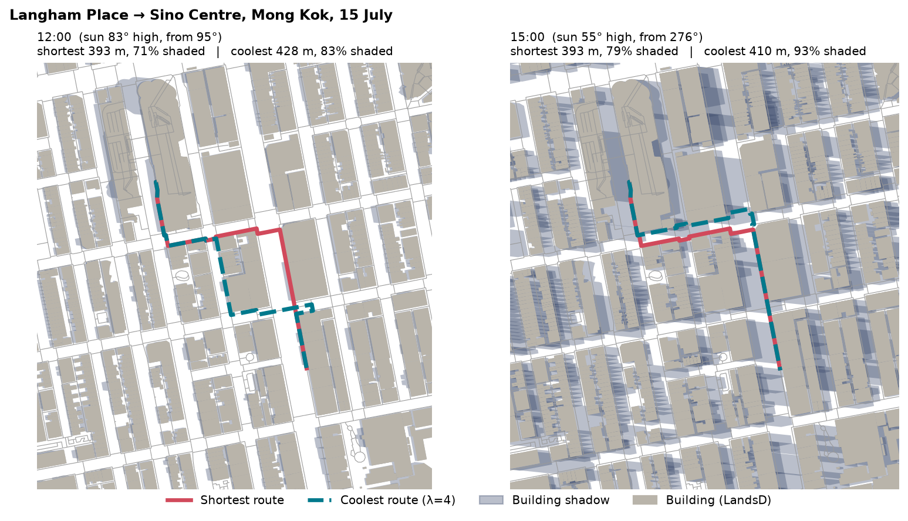
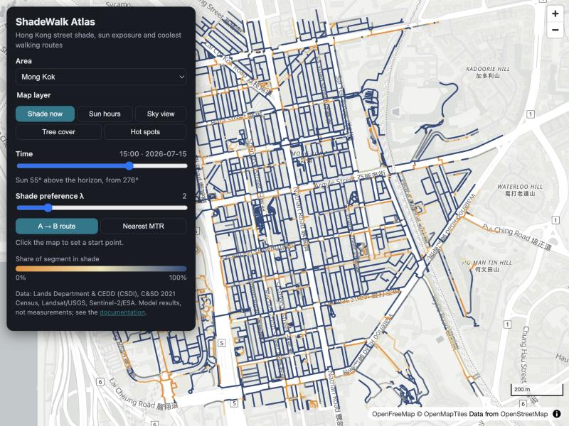
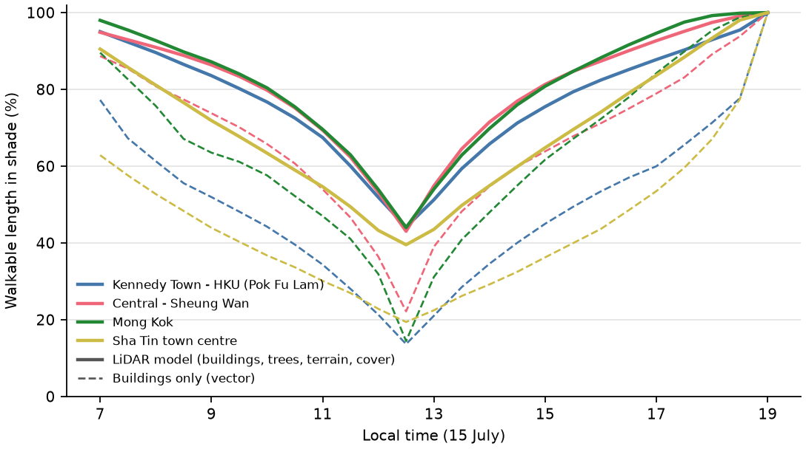
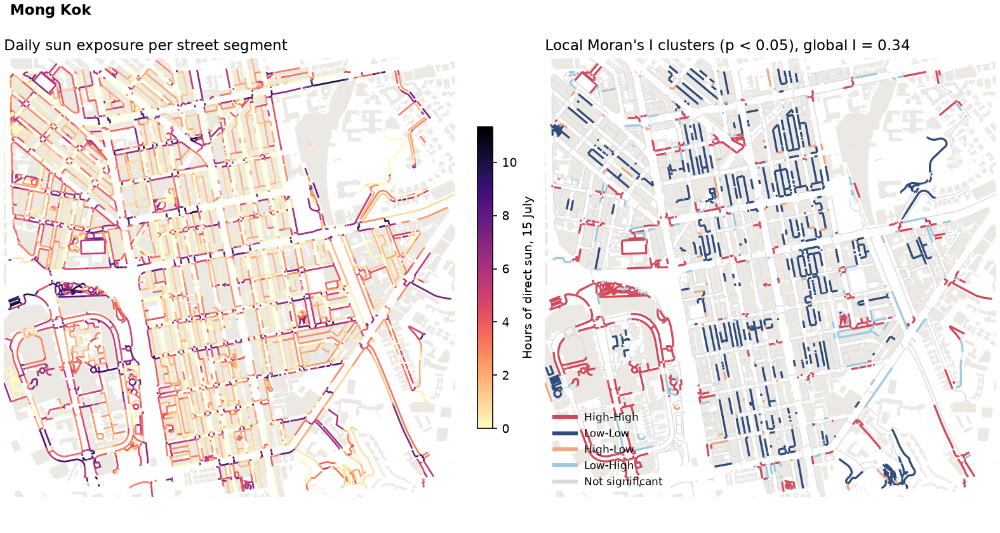

# ShadeWalk HK

**Street-level shade, sun exposure and heat-aware walking for Hong Kong, built from open government LiDAR, 3D building, pedestrian-network and census data plus Landsat and Sentinel-2 imagery.**

[](https://github.com/Yang1107-wzy/shadewalk/actions/workflows/ci.yml)
[](https://yang1107-wzy.github.io/shadewalk/)


Hong Kong summers make the *same* walk feel very different depending on the street, the side of the street and the hour. ShadeWalk models this at the scale of individual footway segments.

1. **Shade at any time of day.** It combines exact building shadows with LiDAR ray-marching, which adds trees, terrain, footbridges and canopies.
2. **Street climate descriptors.** It computes the sky view factor, tree canopy (LiDAR × NDVI), canyon H/W, orientation, coverage and Landsat surface heat.
3. **Coolest routes.** It routes walkers on a distance–sun trade-off, in Python or in the browser.
4. **Spatial statistics.** It analyses where streets are hot and why: Moran's I, LISA, Getis–Ord Gi*, OLS and a spatial-lag model.
5. **Who is exposed.** It allocates 2021 census population to buildings and measures how much sun older residents face on their walk to the MTR.



*Langham Place → Sino Centre, 15 July. At noon a 9% detour raises shade from 71% to 83%. At 15:00 a 4% detour raises it from 79% to 93%. Polygons show LandsD building shadows. Route statistics use the LiDAR model.*

## What's inside

| Layer | Data / method | Module |
|---|---|---|
| Buildings | LandsD *Building* (CSDI WFS): footprints, `TopHeight − BaseHeight` | `data.csdi` |
| Walkable network | LandsD *3D Pedestrian Network*: footbridges, subways, covered and indoor links, one-way escalators, links to transit terminals | `data.csdi`, `network` |
| Surface models | **CEDD 2020 airborne LiDAR** DSM/DTM (0.5 m tiles, discovered via the WFS tile index, mosaicked, max/mean aggregated) | `data.lidar` |
| Sun & shadows | NOAA solar position. Exact LoD1 vector shadows. **DSM ray marching** at pedestrian eye height | `sun`, `shadow`, `raster` |
| Street climate | **Sky view factor** (16 azimuths), overhead cover, **tree canopy** = LiDAR cover × Sentinel-2 NDVI | `raster`, `streetscape`, `data.sentinel` |
| Surface heat | Median summer Landsat 8/9 LST (QA cloud mask) as a relative heat weight | `data.lst`, `exposure` |
| Morphology | Canyon H/W by perpendicular ray casting, orientation, dissolved coverage ratio, mean height, frontal area | `morphology` |
| Spatial statistics | kNN weights, Moran's I, LISA, Gi*, OLS + residual Moran's I, **spatial lag (S2SLS)**, all checked against PySAL | `stats`, `analysis` |
| Accessibility | **Dasymetric** census population (all ages / 65+) → buildings. MTR access points from the terminal table. Multi-source Dijkstra | `data.census`, `access` |
| Routing | Dijkstra on `length + λ·exposure`, with a λ sweep for the Pareto set | `routing` |
| Scale | Tiled parallel builds with deterministic merge (district scale) | `region` |
| Delivery | CLI, Python API, GeoParquet/GeoPackage, Streamlit app, **static MapLibre web atlas with in-browser routing** | `cli`, `atlas`, `web/`, `app/` |

## Quick start

```bash
git clone https://github.com/Yang1107-wzy/shadewalk && cd shadewalk
pip install -e ".[lst,app]"

# Bundled demo data (five areas, LiDAR model, 15 July 2026) works offline:
shadewalk route mong_kok --from "Langham Place" --to "Sino Centre" --time 15:00 --lambda 4 --out demo_data
```

```
                 Mong Kok | 2026-07-15 15:00
┏━━━━━━━━━━┳━━━━━━━━━━━━┳━━━━━━━━━━━━┳━━━━━━━━┳━━━━━━━━━━━━━━┓
┃          ┃ length (m) ┃ in sun (m) ┃ shaded ┃ surface temp ┃
┡━━━━━━━━━━╇━━━━━━━━━━━━╇━━━━━━━━━━━━╇━━━━━━━━╇━━━━━━━━━━━━━━┩
│ shortest │        393 │         82 │    79% │       43.3 C │
│ coolest  │        410 │         27 │    93% │       43.4 C │
└──────────┴────────────┴────────────┴────────┴──────────────┘
Detour +4% buys 56 m less walking in the sun.
```

Build your own area from live open data:

```bash
shadewalk build sha_tin --date 2026-08-01 --lidar           # LiDAR + NDVI + LST, ~1-5 min
shadewalk region ytm 114.163,22.293,114.180,22.326 --lidar --workers 3   # tiled district build
shadewalk analyze sha_tin                                    # Moran's I, LISA, Gi*, OLS, spatial lag
shadewalk access sha_tin --time 15:00                        # census-weighted MTR access
shadewalk export sha_tin -o sha_tin.gpkg                     # open in QGIS
shadewalk atlas sha_tin && python -m http.server -d web      # static web map
```

## Web atlas



`web/` is a serverless MapLibre app, deployed at `/atlas/` on the docs site. It offers:

* Shade at any half-hour, sun hours, sky view factor, tree cover and LISA hot/cool spots.
* A → B shortest vs coolest routes.
* "Coolest walk to the nearest MTR".

Routing runs in the browser. `web/router.js` mirrors `shadewalk.routing`, and a test checks that the two agree.

## Results (bundled areas, 15 July 2026)

**Shade through the day.** The LiDAR model (solid lines) adds trees, terrain and overhead structures to the building-only vector model (dashed). Treat the two as upper and lower bounds.



**Where are streets hot, and why?** Daily sun hours are strongly spatially clustered: Moran's I is 0.34–0.53 across five areas, with p ≤ 0.001. Morphology explains 74–90% of the variance (OLS R²).

* **Sky view factor** dominates: standardised β = 0.83 in Yau Tsim Mong.
* **Tree canopy** (β = −0.10) and **deeper canyons** (H/W, β = −0.07) reduce exposure beyond geometry alone.

A spatial-lag model (S2SLS) confirms these effects after accounting for the remaining spatial dependence. See [street analysis](docs/analysis.md).



**How much sun can a detour avoid?** For 100 random 0.4–1.2 km trips per area at λ = 2, the coolest route is on average **4.7–19.6% longer** and cuts sunlit walking by **20–66%** ([case study](docs/case-study.md)).

**Who is exposed on the way to the MTR?** Census population was allocated to buildings by floor area.

* **Mong Kok, 15:00.** The share of residents aged 65+ whose shortest walk to an MTR station has more than 200 m in direct sun drops from **11.6% to 0.1%** on the coolest route. The median detour is 28 m.
* **Noon.** Re-routing cannot remove most of the exposure: 44.7% → 31.1% in Yau Tsim Mong.
* **Sha Tin.** Long distances to the station keep exposure high at every hour.

These are the places where shade infrastructure, rather than navigation, is needed ([access results](docs/analysis.md#3-walking-access-to-the-mtr-2021-census)).

## Validation

| Check | Result |
|---|---|
| Vector shadows vs [pybdshadow](https://github.com/ni1o1/pybdshadow) (2,080 buildings, 6 times) | IoU ≥ 0.996 |
| LiDAR ray marching vs exact vector shadows (same buildings, 4 areas × 3 times) | 95–99% of street points agree |
| LiDAR overhead-cover detection vs LandsD `WeatherProof` = Covered | 59–87% detected |
| Moran's I, LISA, Gi* vs `esda`, S2SLS vs `spreg.GM_Lag` | identical to numerical precision |
| Browser router (Node) vs Python router | same length and sunlit metres |
| Solar geometry | solstice / equinox analytic checks |

The full numbers are on the [Validation](docs/validation.md) page. All 61 tests run offline in about 6 s, and CI covers Linux and macOS with Python 3.10–3.12.

## Limitations

* **LiDAR shade is an upper bound.** At 1 m, facades, signboards and shop canopies next to footways count as overhead cover. The 2020 LiDAR is also a snapshot in time. The vector building model (`bshade_*`) is the lower bound.
* **LST is surface skin temperature,** not air temperature or thermal comfort. It is used only as a relative weight.
* **Population is dasymetric.** Residents are spread in proportion to floor area, so commercial floors in mixed LSUGs dilute it. The meaning of the census age bands (`age_5` = 65+) was checked against territory-wide totals (19.6% of 7.41 M), not against an official field dictionary.
* **2D network snapping (0.5 m) and fare-paid areas.** Paid areas are excluded, and opening hours of indoor links are ignored.

## Documentation

[Architecture](docs/architecture.md) · [Method](docs/method.md) · [Tutorial](docs/tutorial.md) · [Case study](docs/case-study.md) · [Street analysis & MTR access](docs/analysis.md) · [Validation](docs/validation.md) · [Web atlas](docs/web-atlas.md) · API reference on the docs site.

Every figure and table can be regenerated from scripts in `scripts/` (`case_study.py`, `district_report.py`, `validate_lidar.py`, `validate_pybdshadow.py`, `make_figures.py`, `render_docs.py`).

## Data and attribution

* Building, pedestrian network and terminal data © Lands Department, HKSAR Government.
* LiDAR © Civil Engineering and Development Department, HKSAR Government.
* 2021 Census © Census and Statistics Department, HKSAR Government.
* All of the above were obtained from the [CSDI Portal](https://portal.csdi.gov.hk) / [DATA.GOV.HK](https://data.gov.hk).
* Contains modified Copernicus Sentinel data. Landsat courtesy of the U.S. Geological Survey. Both were accessed through [Microsoft Planetary Computer](https://planetarycomputer.microsoft.com).
* The web basemap is from OpenFreeMap / © OpenStreetMap contributors.

See [DATA_ATTRIBUTION.md](DATA_ATTRIBUTION.md).

## Citation & license

Cite via [CITATION.cff](CITATION.cff). The code is MIT-licensed. The bundled `demo_data/` and `web/data/` remain subject to the source data licences above.
