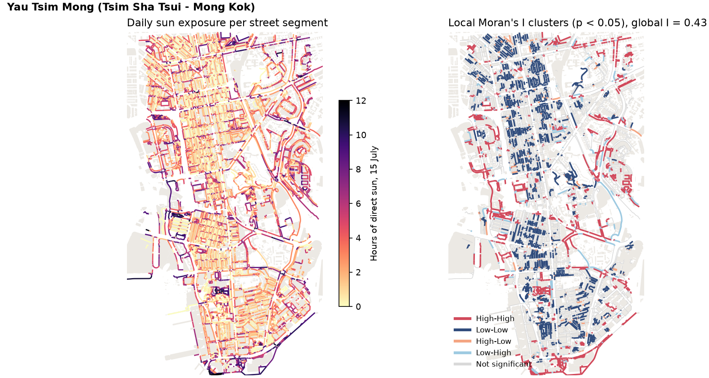
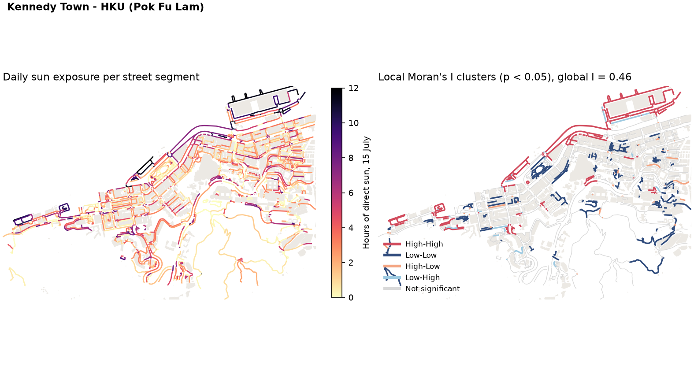
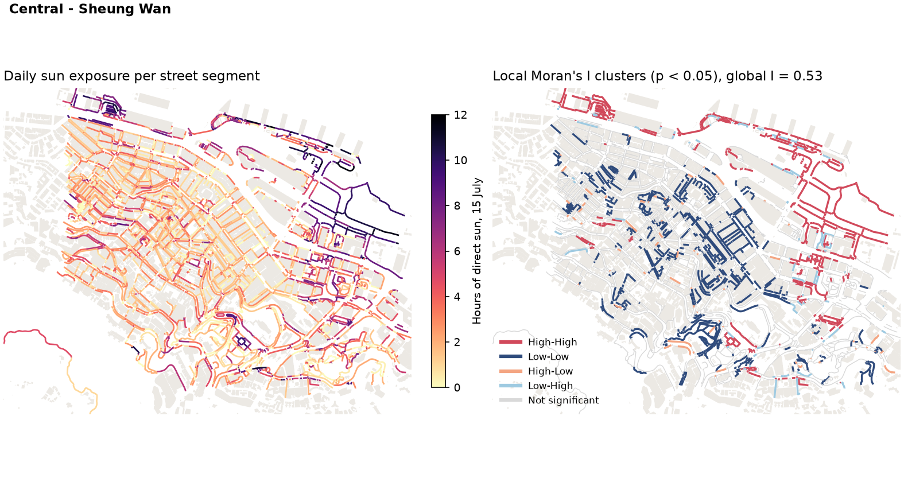
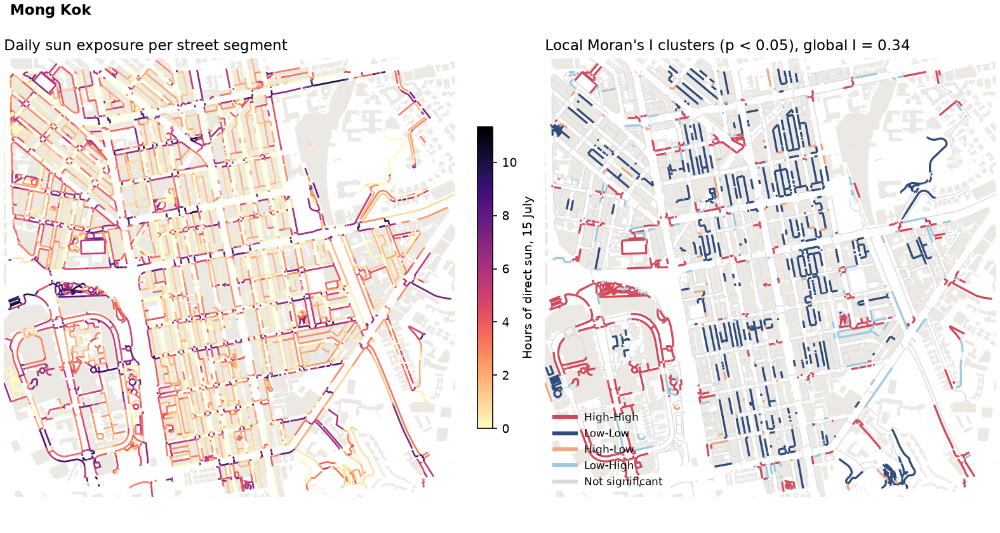
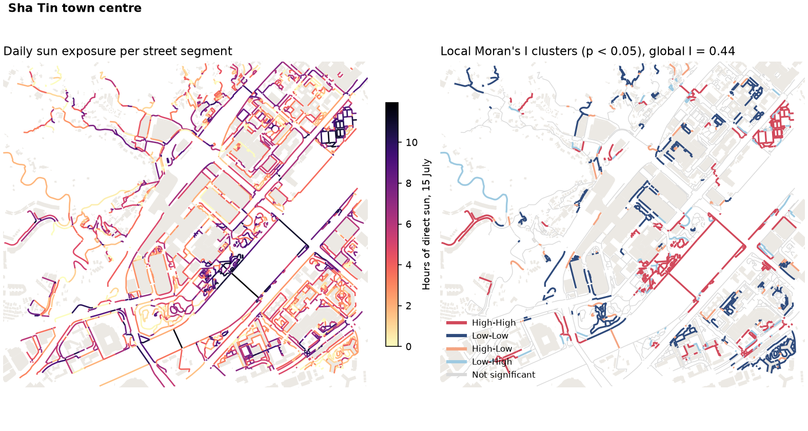
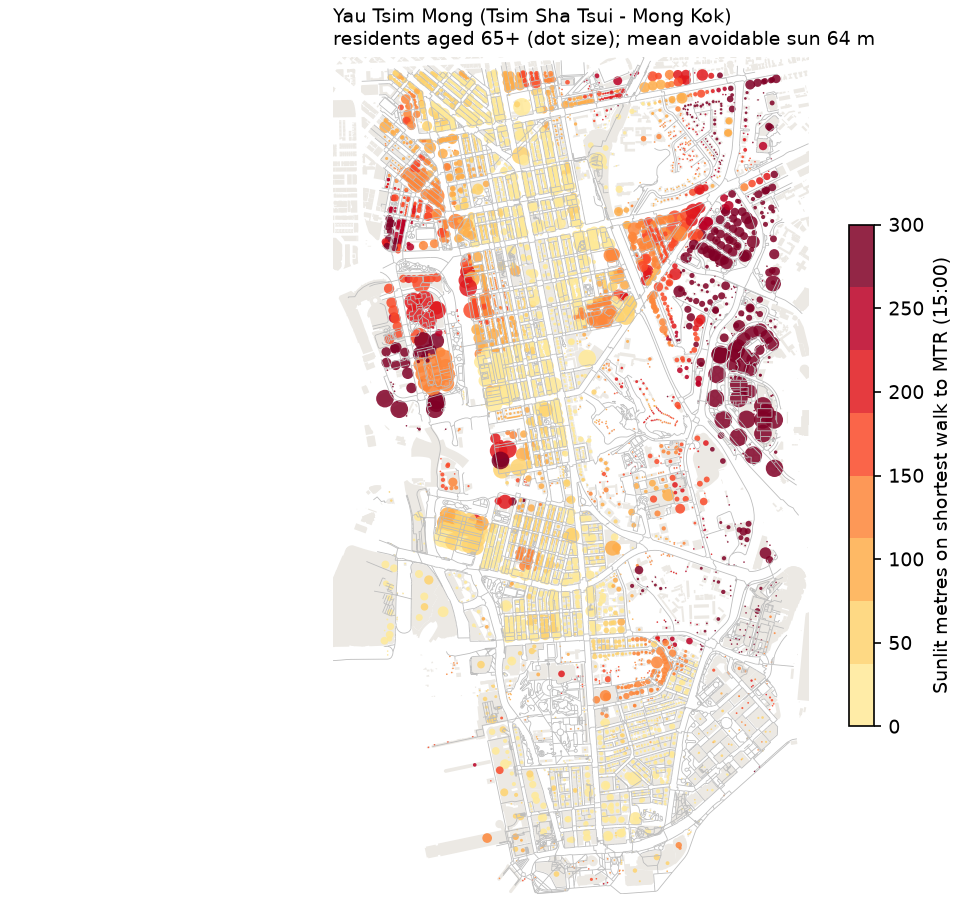
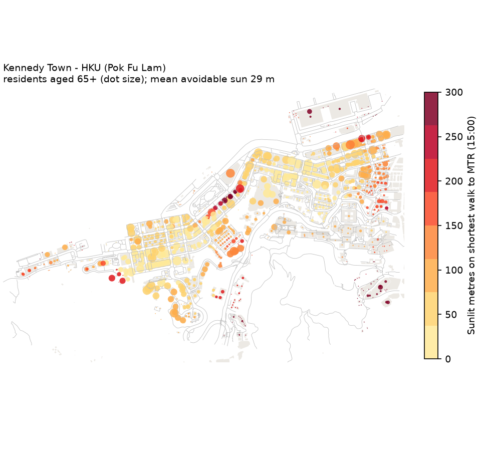
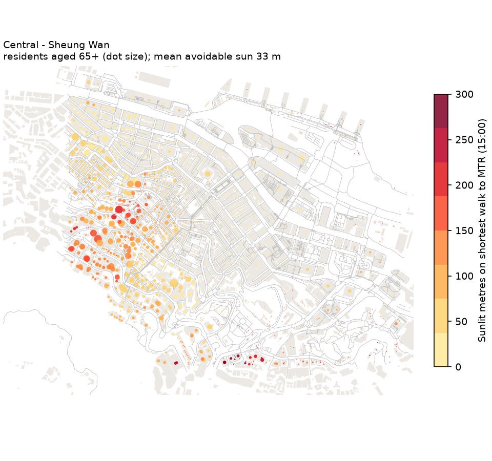
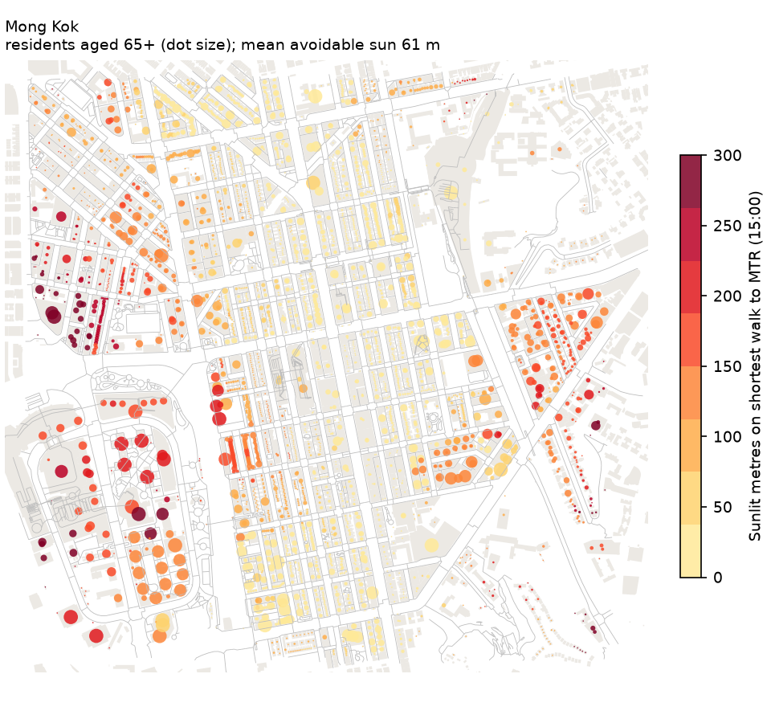
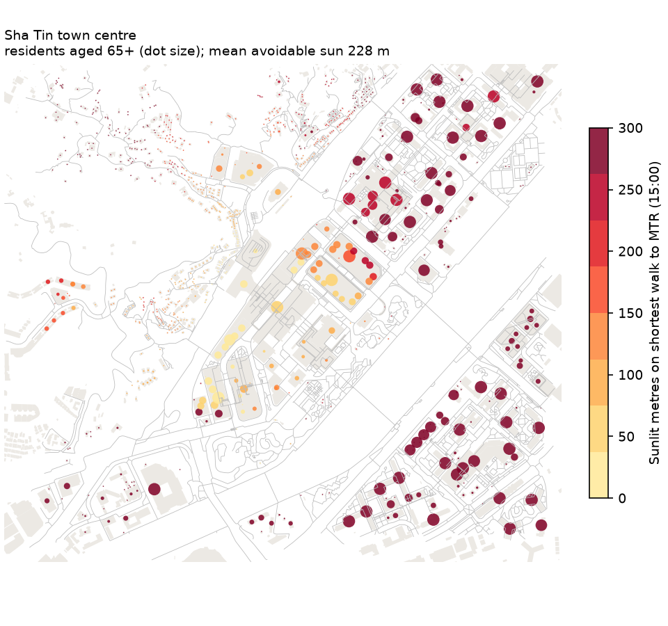

# Street analysis and MTR accessibility

All numbers on this page are generated from `docs/analysis/summary.json` by `scripts/render_docs.py`, and that file is produced by `scripts/district_report.py`. The analysis unit is the outdoor, uncovered street segment (≥ 5 m), and the response variable is **hours of direct sun on 15 July** from the LiDAR model.

## 1. Street-level LiDAR metrics

| Area | Median street SVF | Overhead cover (length share) | Tree-canopy share |
|---|---:|---:|---:|
| Yau Tsim Mong | 0.10 | 38.0% | 11.0% |
| Kennedy Town–HKU | 0.09 | 38.2% | 22.3% |
| Central–Sheung Wan | 0.08 | 35.6% | 11.4% |
| Mong Kok | 0.09 | 39.8% | 8.4% |
| Sha Tin | 0.19 | 35.6% | 18.0% |

## 2. Spatial autocorrelation and explanatory models

Spatial weights: 8 nearest neighbours, row-standardised. Inference uses 999 permutations.

| Area | Street km | Outdoor segments | Moran's I (sun hours) | LISA hot / cool clusters | OLS R² | Residual Moran's I | Spatial lag ρ |
|---|---:|---:|---:|---:|---:|---:|---:|
| Yau Tsim Mong | 279.1 | 10,274 | 0.425 | 1,638 / 1,864 | 0.781 | 0.222 | -0.126 |
| Kennedy Town–HKU | 64.2 | 2,005 | 0.461 | 248 / 349 | 0.835 | 0.162 | -0.196 |
| Central–Sheung Wan | 119.1 | 3,973 | 0.532 | 524 / 794 | 0.812 | 0.303 | -0.149 |
| Mong Kok | 111.8 | 4,299 | 0.343 | 600 / 582 | 0.735 | 0.213 | -0.116 |
| Sha Tin | 83.3 | 2,631 | 0.443 | 466 / 506 | 0.896 | 0.235 | -0.082 |

Sun exposure is strongly clustered in every district (all Moran's I p ≤ 0.001). The LISA maps below separate **hot streets** (High-High: wide, open roads and waterfronts) from **cool streets** (Low-Low: narrow canyons, tree-lined and arcaded streets).

**Coefficients for Yau Tsim Mong** (the largest area, standardised variables):

| Term | OLS β (std.) | HC1 t | Spatial-lag β | z |
|---|---:|---:|---:|---:|
| Intercept | -0.000 | -0.0 | 0.003 | 0.7 |
| Canyon aspect ratio log(1+H/W) | -0.069 | -11.6 | -0.071 | -12.1 |
| Orientation cos 2θ (N–S +) | -0.052 | -10.4 | -0.058 | -11.9 |
| Orientation sin 2θ (NE–SW +) | 0.002 | 0.5 | 0.004 | 0.7 |
| Building coverage (50 m) | 0.020 | 3.6 | 0.007 | 1.2 |
| Mean building height (50 m) | -0.001 | -0.2 | 0.003 | 0.7 |
| Sky view factor | 0.825 | 110.7 | 0.877 | 111.9 |
| Tree-canopy share | -0.103 | -25.0 | -0.104 | -17.0 |
| Spatial lag ρ | – | – | -0.126 | -11.1 |

The sky view factor is the dominant predictor of sun exposure. Tree canopy reduces exposure beyond what the geometry explains, and deeper canyons (higher H/W) are cooler. The OLS residuals are still spatially autocorrelated, so the spatial-lag model (S2SLS) is reported alongside. Its coefficients are close to the OLS ones, which suggests the morphology effects are robust to spatial dependence.

## 3. Walking access to the MTR (2021 Census)

Population of each Large Subunit Group is allocated to its buildings by floor area. Destinations are the street-level access points of MTR stations from the LandsD terminal table. λ = 2.0. Residents more than 80 m from the network, and buildings outside the area's bbox, are excluded.

| Area | Time | Residents (65+) | Median walk to MTR | Within 500 m | Median sun (shortest → coolest) | Median extra walk | 65+ with >200 m sun (shortest → coolest) |
|---|---|---:|---:|---:|---:|---:|---:|
| Yau Tsim Mong | 09:00 | 279,242 (57,170) | 411 m | 60.1% | 46 → 16 m | 12 m | 19.6% → 2.1% |
| Yau Tsim Mong | 12:00 | 279,242 (57,170) | 411 m | 60.1% | 165 → 109 m | 17 m | 44.7% → 31.1% |
| Yau Tsim Mong | 15:00 | 279,242 (57,170) | 411 m | 60.1% | 85 → 26 m | 18 m | 26.2% → 15.9% |
| Kennedy Town–HKU | 09:00 | 101,735 (21,233) | 347 m | 81.9% | 21 → 16 m | 4 m | 0.9% → 0.2% |
| Kennedy Town–HKU | 12:00 | 101,735 (21,233) | 347 m | 81.9% | 150 → 112 m | 8 m | 36.4% → 16.3% |
| Kennedy Town–HKU | 15:00 | 101,735 (21,233) | 347 m | 81.9% | 56 → 29 m | 11 m | 3.9% → 0.5% |
| Central–Sheung Wan | 09:00 | 54,350 (9,902) | 731 m | 34.7% | 26 → 8 m | 21 m | 3.6% → 0.0% |
| Central–Sheung Wan | 12:00 | 54,350 (9,902) | 731 m | 34.7% | 390 → 154 m | 96 m | 74.6% → 31.2% |
| Central–Sheung Wan | 15:00 | 54,350 (9,902) | 731 m | 34.7% | 73 → 38 m | 8 m | 1.9% → 0.2% |
| Mong Kok | 09:00 | 147,818 (29,242) | 431 m | 58.4% | 39 → 15 m | 9 m | 2.6% → 0.0% |
| Mong Kok | 12:00 | 147,818 (29,242) | 431 m | 58.4% | 165 → 111 m | 16 m | 39.3% → 20.1% |
| Mong Kok | 15:00 | 147,818 (29,242) | 431 m | 58.4% | 92 → 20 m | 28 m | 11.6% → 0.1% |
| Sha Tin | 09:00 | 68,380 (18,092) | 985 m | 21.7% | 209 → 108 m | 111 m | 58.2% → 54.1% |
| Sha Tin | 12:00 | 68,380 (18,092) | 985 m | 21.7% | 609 → 317 m | 121 m | 87.7% → 66.0% |
| Sha Tin | 15:00 | 68,380 (18,092) | 985 m | 21.7% | 499 → 168 m | 113 m | 84.7% → 54.6% |

* **Dense districts, morning and afternoon:** in Mong Kok, Central and Kennedy Town, re-routing alone almost eliminates long sunlit walks to the MTR for older residents, at a median cost of a few tens of metres.
* **Noon:** a large share of residents cannot avoid long sunlit walks even on the coolest route. That pattern marks where **shade infrastructure** (covered walkways, street trees) would help most.
* **Sha Tin:** with fewer stations and longer walks, most older residents face more than 200 m of sun at every hour tested, even on the coolest route. Distance, not route choice, is the binding constraint there.

## Caveats

Dasymetric allocation assumes residents are spread in proportion to floor area (including commercial floors in mixed LSUGs). Only MTR stations inside each area are destinations, so residents near the bbox edge may have a closer station outside it. LiDAR shade is an upper bound (see [Validation](validation.md)).
