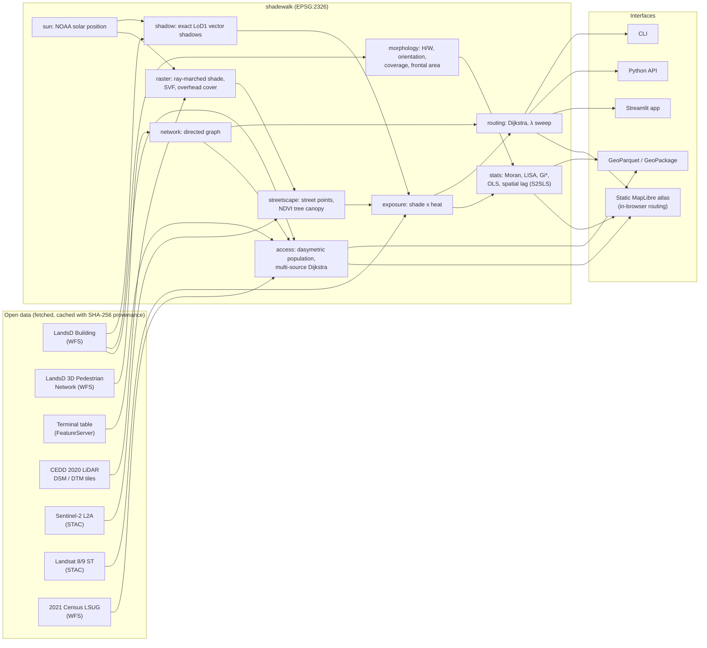

# Architecture

| Module | Responsibility |
|---|---|
| `shadewalk.data.*` | Loaders: CSDI WFS/FeatureServer paging, LiDAR tile index and mosaics, Planetary Computer STAC composites (Landsat LST, Sentinel-2 NDVI), census, HKO weather, and the provenance cache |
| `shadewalk.sun`, `shadow` | Solar geometry and exact vector building shadows |
| `shadewalk.raster`, `streetscape` | DSM ray marching, sky view factor, overhead cover, tree canopy at street level |
| `shadewalk.exposure`, `network`, `routing` | Segment shade fraction, heat weight and exposure; graph building; shortest/coolest routes |
| `shadewalk.morphology`, `stats`, `analysis` | Street-canyon descriptors, spatial statistics, daily metrics and the per-area analysis |
| `shadewalk.access` | Dasymetric population and population-weighted MTR accessibility |
| `shadewalk.pipeline`, `region` | Area build/load, tiled parallel district builds and merging |
| `shadewalk.atlas`, `viz`, `cli` | Web-atlas export, folium maps, command line |
| `web/` | Static MapLibre front-end with a JS router that mirrors `routing.py` |
