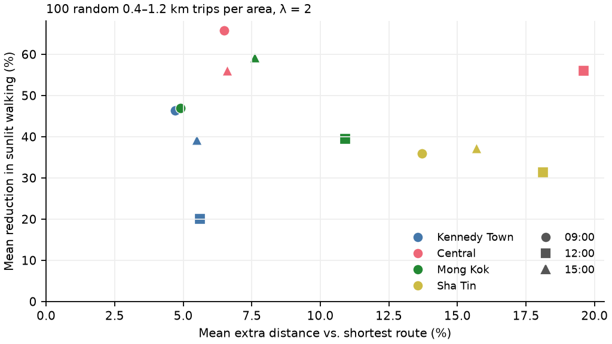

# Case study: what does a small detour buy?

**Question.** On a summer day, how much walking in direct sun can a pedestrian avoid by accepting a modest detour? And how does that differ between dense high-rise districts and lower-rise new towns?

**Setup.** The four bundled areas are built for 15 July 2026 with the LiDAR shade model (buildings, trees, terrain and overhead cover), 30-minute slots and \(\beta = 1\). In each area, 100 origin–destination node pairs are sampled at random (seed 42), 400–1200 m apart in a straight line and connected in the network. Every pair is routed at 09:00, 12:00 and 15:00, once with \(\lambda = 0\) (shortest) and once with each of \(\lambda \in \{2, 4\}\).

* *Mean extra distance* is the mean over trips of \(\ell_\text{cool} / \ell_\text{short} - 1\).
* *Mean cut in sunlit walking* is the mean over trips of \((\text{sun}_\text{short} - \text{sun}_\text{cool}) / \text{sun}_\text{short}\). Trips whose shortest route is already fully shaded count as 0.
* *Trips rerouted* is the share of trips whose coolest route differs from the shortest, including a switch to the shaded footway on the other side of the same street at no extra cost.

## λ = 2

| Area | Time | Shortest routes shaded | Mean extra distance | Mean cut in sunlit walking | Mean sunlit metres avoided | Trips rerouted |
|---|---|---:|---:|---:|---:|---:|
| Central–Sheung Wan | 09:00 | 89% | +6.5% | −65.8% | 89 m | 89% |
| Central–Sheung Wan | 12:00 | 51% | +19.6% | −56.1% | 282 m | 99% |
| Central–Sheung Wan | 15:00 | 84% | +6.6% | −56.1% | 106 m | 90% |
| Kennedy Town–HKU | 09:00 | 89% | +4.7% | −46.4% | 71 m | 83% |
| Kennedy Town–HKU | 12:00 | 56% | +5.6% | −20.1% | 108 m | 95% |
| Kennedy Town–HKU | 15:00 | 78% | +5.5% | −39.2% | 113 m | 96% |
| Mong Kok | 09:00 | 86% | +4.9% | −46.9% | 76 m | 96% |
| Mong Kok | 12:00 | 54% | +10.9% | −39.5% | 196 m | 98% |
| Mong Kok | 15:00 | 78% | +7.6% | −59.3% | 142 m | 98% |
| Sha Tin | 09:00 | 58% | +13.7% | −36.0% | 200 m | 95% |
| Sha Tin | 12:00 | 34% | +18.1% | −31.4% | 265 m | 98% |
| Sha Tin | 15:00 | 56% | +15.7% | −37.2% | 210 m | 98% |

## λ = 4

| Area | Time | Shortest routes shaded | Mean extra distance | Mean cut in sunlit walking | Mean sunlit metres avoided | Trips rerouted |
|---|---|---:|---:|---:|---:|---:|
| Central–Sheung Wan | 09:00 | 89% | +8.5% | −71.1% | 95 m | 91% |
| Central–Sheung Wan | 12:00 | 51% | +30.8% | −62.1% | 309 m | 100% |
| Central–Sheung Wan | 15:00 | 84% | +13.0% | −64.8% | 119 m | 94% |
| Kennedy Town–HKU | 09:00 | 89% | +7.2% | −52.0% | 78 m | 86% |
| Kennedy Town–HKU | 12:00 | 56% | +9.1% | −21.0% | 113 m | 96% |
| Kennedy Town–HKU | 15:00 | 78% | +7.9% | −41.3% | 118 m | 97% |
| Mong Kok | 09:00 | 86% | +8.7% | −51.6% | 84 m | 98% |
| Mong Kok | 12:00 | 54% | +16.0% | −41.5% | 205 m | 99% |
| Mong Kok | 15:00 | 78% | +13.2% | −65.8% | 154 m | 99% |
| Sha Tin | 09:00 | 58% | +22.4% | −39.9% | 220 m | 96% |
| Sha Tin | 12:00 | 34% | +27.4% | −34.0% | 286 m | 98% |
| Sha Tin | 15:00 | 56% | +23.5% | −41.0% | 232 m | 98% |

## Reading the results

* **Across areas and times, at λ = 2:** the coolest route is on average 4.7–19.6% longer and cuts sunlit walking by 20.1–65.8%.
* **Best trade-off:** Central–Sheung Wan at 09:00, where a +6.5% detour removes 65.8% of the sunlit walking. Dense grids with tall frontages offer shaded alternatives of almost the same length.
* **Noon is the hardest time.** With the sun at ≈ 83° in mid-July, the shortest routes are only 34–56% shaded, and detours get longer.
* **Lower-rise Sha Tin needs the longest detours,** 13.7–18.1% at λ = 2.

## Caveats

These are model results, not field measurements. The LiDAR model treats any overhead obstruction (trees, canopies, signboards) as shade and can over-count near facades; building-only figures are in `bshade_*` (see [Validation](validation.md)). The random trips are not weighted by real pedestrian demand. Per-trip results are in `docs/case_study/results.csv`. Reproduce with `python scripts/case_study.py --outputs demo_data`.
