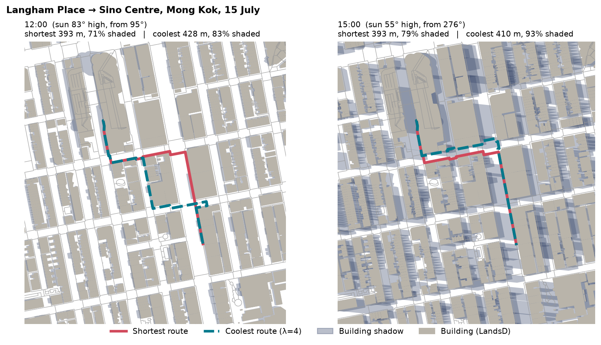

# ShadeWalk HK

ShadeWalk turns Hong Kong's open LiDAR, 3D building, pedestrian-network and census data, plus Landsat and Sentinel-2 imagery, into **street-level shade and sun-exposure models**. On top of these it provides **coolest-route navigation**, **spatial statistics** of where streets are hot and why, and **population-weighted accessibility** analysis.



<div class="grid" markdown>

* **[Method](method.md):** vector and LiDAR shadows, sky view factor, tree canopy, morphology, spatial statistics, dasymetric accessibility.
* **[Results](analysis.md):** Moran's I, LISA hot/cool streets, OLS and spatial-lag models, and MTR access for residents aged 65+.
* **[Validation](validation.md):** checks against pybdshadow, vector-vs-raster agreement, cover vs `WeatherProof`, and PySAL parity.
* **[Web atlas](../atlas/):** a serverless MapLibre app with in-browser routing ([about](web-atlas.md)).

</div>

```bash
pip install -e ".[lst,app]"
shadewalk build mong_kok --date 2026-07-15 --lidar
shadewalk analyze mong_kok
shadewalk access mong_kok --time 15:00
shadewalk route mong_kok --from "Langham Place" --to "Sino Centre" --time 15:00 --lambda 4
```
